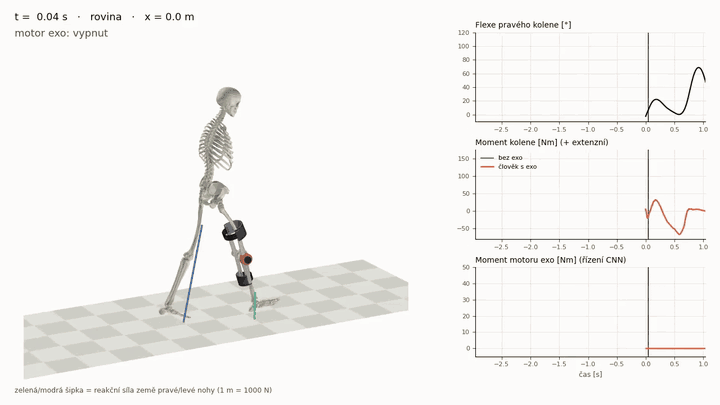

# Knee exoskeleton for stair ascent – OpenSim simulation

Simulation of a 15 m walk (10.6 m level ground + 17 stairs) with **OpenSim 4.5**. A
**right-knee exoskeleton** (parametric CAD) is added to the model, and its motor is switched
**ON/OFF by a 1D convolutional neural network** that sees the last 1 s of knee angle and
thigh/shank angular velocity at 20 Hz.



*The camera follows the pelvis. Left: skeleton with the exoskeleton and ground reaction forces
(green/blue arrows, 1 m = 1000 N). Right: knee flexion, knee moment (no exo vs. human with
exo) and motor torque. Shading marks the time the motor is ON.
Full-resolution video: [`test2/results/animace/chuze_exo_email.mp4`](test2/results/animace/chuze_exo_email.mp4).*

## Key results (right knee, stair ascent, mean of 6 steps)

| | no exo | exo, CNN ON/OFF control | change |
|---|---|---|---|
| Peak knee extension moment | 162 N·m | 122 N·m | −25 % |
| Knee extension impulse | 37.9 N·m·s | 26.1 N·m·s | −31 % |
| Positive work of knee muscles | 72 J / step | 53 J / step | −26 % |
| Motor activations on level ground | – | 0 | – |

The full report (in Czech) with all methods, figures and limitations:
[`test2/zprava/zprava_exoskelet.pdf`](test2/zprava/zprava_exoskelet.pdf).

## How the OpenSim model works

The simulation is **inverse dynamics with prescribed kinematics** (`InverseDynamicsTool`).
The motion `q(t)` is an input; joint velocities and accelerations come from differentiating it.
Ground reaction forces are applied as external loads. At each time instant the equations of motion

    M(q)·q̈ + c(q, q̇) + g(q) = τ + Jᵀ·F_GRF + τ_exo

are solved algebraically for the net joint moments `τ`, with no time integration. The equations are
linear in the exoskeleton torque, so the moment the human has to produce is
`M_human = M_passive_exo − τ_exo`. This was verified against OpenSim to within 0.06 N·m.
The approach assumes the human walks the same way with and without the exoskeleton.
Gait adaptation would require a forward (muscle-driven) simulation, e.g. OpenSim Moco.

## Repository structure

| Folder | Content |
|---|---|
| [`test1/`](test1) | Base simulation: model *Gait10dof18musc* (72.6 kg). Level walking is measured data (OpenSim example) converted from treadmill to overground and repeated. Stair kinematics are synthesized (feet placed on 170/290 mm steps, inverse kinematics) and the ground forces are computed from whole-body dynamics. Output: hip/knee/ankle moments and powers of the right leg. |
| [`test2/`](test2) | Exoskeleton: CAD model, OpenSim model with the exo, controllers (knee-angle law, user template, CNN), animation and PDF report. |
| [`docs/`](docs) | Media for this page. |

### test2 in more detail

* **CAD** (`test2/cad/`, `scripts/exo_cad.py`): bilateral knee brace, 1.76 kg. Lateral BLDC motor with a
  harmonic drive, aluminium uprights, composite thigh/calf cuffs with straps. STL parts in mm, assembly
  and bill of materials. Mass, center of mass and inertia are computed from the meshes. The exo hinge
  axis is placed by least squares to match the moving knee axis of the model (max. misalignment
  2 mm over 0–110°).
* **OpenSim model** (`test2/model/subject01_stairs_exo.osim`): the exo links are welded to femur and tibia.
  Ground reaction forces are corrected for the exo mass.
* **Controllers**
  * `exo_control.py`: torque as a function of knee angle (`τ = G(θ)·s(ω)`), written directly into the
    model as `ExpressionBasedCoordinateForce`.
  * `moje_rizeni.py` + `run_moje_rizeni.py`: template for your own Python controller (inputs: knee
    angle, thigh and shank angular velocity; output: torque or ON/OFF) and its evaluation.
  * **CNN** (`cnn_train.py`, `cnn_rizeni.py`): 3×20 input window (1 s at 20 Hz), 3 Conv1D + 2 dense
    layers, 2,533 parameters. Labels are taken from the knee moment of normal walking:
    ON ⇔ knee moment > 40 N·m while the right foot stands on a stair. Assistance is for stairs only.
    Training uses augmentation (speed ±15 %, gain, sensor bias and noise). On held-out cycles the
    test F1 is 0.99 (0.95–0.98 with doubled noise or ±15 % speed). Inference is reimplemented in
    plain numpy for embedded use.
* **Animation** (`anim_export.py` → `anim_render.py`): body poses from OpenSim, rendered with matplotlib,
  encoded to H.264.
* **Report** (`test2/zprava/`): XeLaTeX source; figures and numbers come from `zprava_grafy.py`.

## Requirements and running

* OpenSim 4.5 with its Python bindings (Python 3.8) in `C:\OpenSim 4.5`, used for all steps that need OpenSim.
* Python 3.11 with PyTorch, matplotlib, OpenCV and `imageio-ffmpeg`, used for CNN training,
  animation rendering and report figures.
* XeLaTeX (MiKTeX) to build the report.

```bash
cd test1/scripts            # base simulation
py38 tune_transition.py && py38 build_motion.py && py38 compute_dynamics.py && py38 report.py

cd ../../test2/scripts      # exoskeleton
py38 exo_cad.py && py38 build_exo_model.py && py38 run_exo.py && py38 report_exo.py
py311 cnn_train.py && py38 run_moje_rizeni.py cnn_rizeni
py38 anim_export.py && py311 anim_render.py && py311 zprava_grafy.py
```

`py38` / `py311` stand for the respective Python interpreters. Setup XML files in `setup/` and
`data/*.xml` contain absolute paths of the original machine. The scripts regenerate them.

## Limitations

* Level walking is a single measured gait cycle repeated; stair motion is synthetic. The
  stair knee extension moment (2.2 N·m/kg) is likely overestimated compared with the literature
  (1.0–1.6 N·m/kg).
* The CNN is trained on this single, very regular dataset. It must be retrained and validated on
  real IMU/encoder data from several subjects before use on hardware.
* Ideal motor (no friction or reflected inertia) and rigid cuffs; a sagittal-plane model only.
