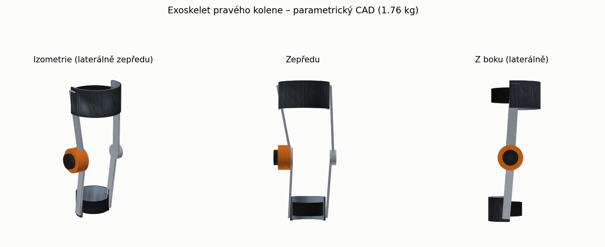
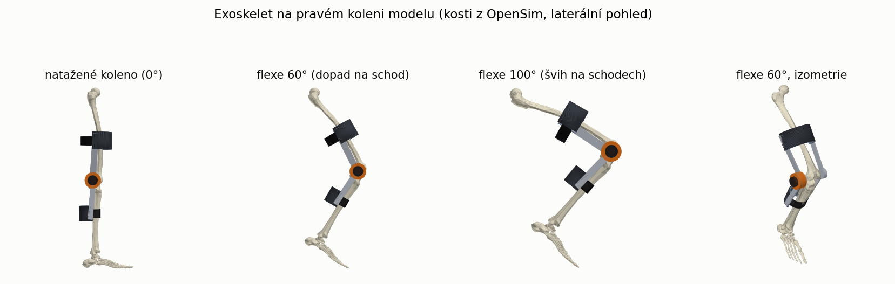
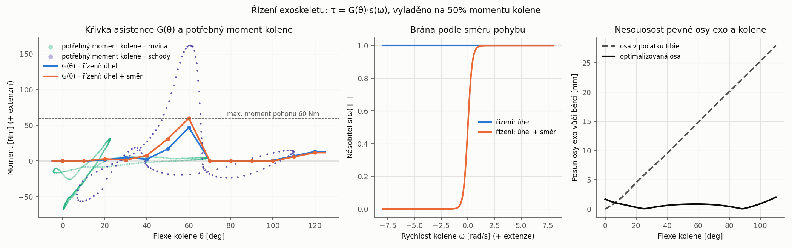
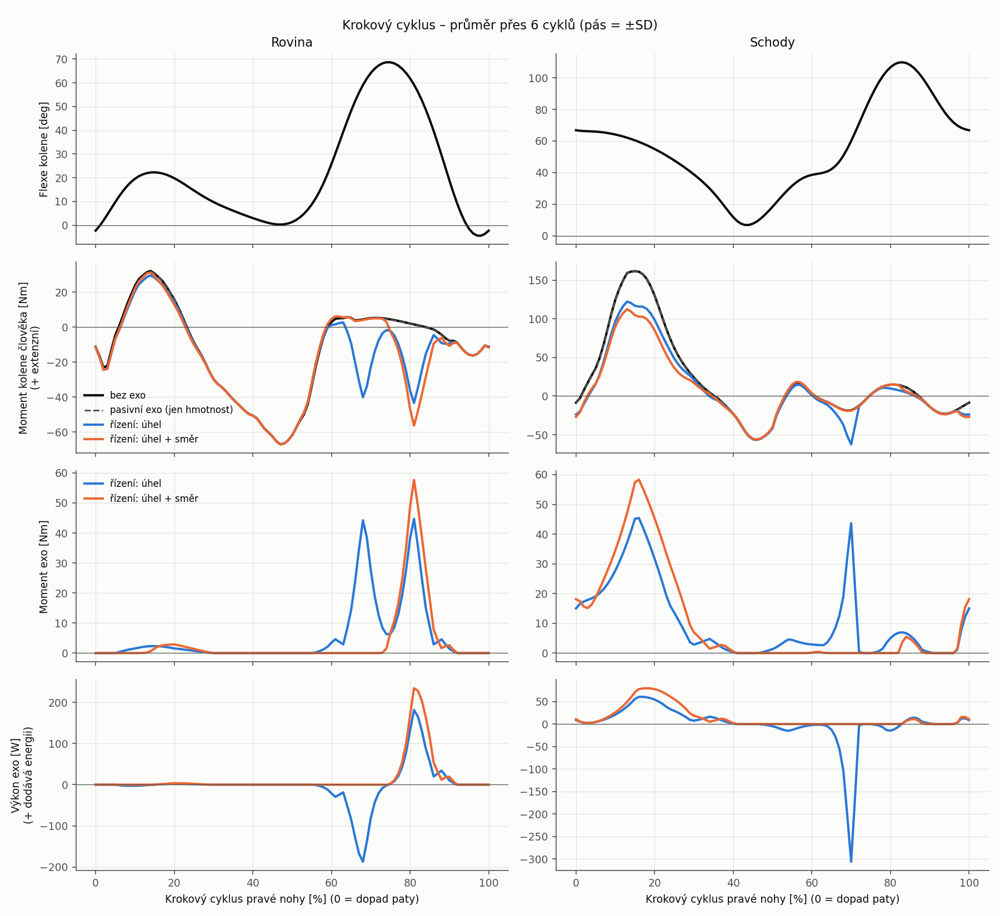

# Exoskelet pravého kolene na modelu z test1 (OpenSim 4.5)

Výchozí stav: model, kinematika a reakční síly z `../test1` (15 m chůze: 10,6 m rovina + 17 schodů).
Nové v test2:

1. **CAD exoskeletu** na pravém koleni (parametrický, generovaný Pythonem).
2. **Model OpenSim s exoskeletem**: hmotnost a setrvačnost z CAD, geometrie STL.
3. **Řízení exoskeletu jako funkce úhlu v koleni** přímo v modelu (`ExpressionBasedCoordinateForce`),
   vyladěné na data z test1 a vyhodnocené inverzní dynamikou.

## CAD (`cad/`)




Konstrukce je oboustranná. **Laterálně** je pohon (BLDC motor s vlnovým převodem, 0,72 kg)
a elektronika (0,10 kg), **mediálně** pasivní kloub. Ramena jsou z hliníku 7075.
Na stehně je přední kompozitová objímka se zadním páskem, na bérci zadní objímka na lýtku
s předním páskem. Pro extenzní moment je to správné uspořádání: objímka tlačí na stehno zepředu
a na lýtko zezadu. Celkem **1,76 kg**: článek stehna 1,34 kg, článek bérce 0,42 kg.

| Soubor | Obsah |
|---|---|
| `exo_*_mm.stl` | jednotlivé díly v mm (pro CAD nebo 3D tisk) |
| `exo_koleno_sestava_mm.stl` | celá sestava, koleno natažené |
| `kusovnik.md` | díly, materiály, hmotnosti, rozměry, těžiště a setrvačnost článků |
| `exo_hmotnosti.json` | hmotnostní vlastnosti článků, které používá model |
| `osa_kloubu.json` | poloha osy exoskeletu a průběh nesouososti |

Všechny rozměry jsou v `scripts/exo_params.py`: poloměry stehna a lýtka, výšky objímek,
šířka kolene, pohon a materiály. CAD se znovu vytvoří příkazem `exo_cad.py`.

**Osa kloubu.** Koleno v modelu nemá pevnou osu, protože tibie se při flexi posouvá.
Pevná osa exoskeletu je proto umístěna metodou nejmenších čtverců tak, aby se v rozsahu
0–110° co nejméně odchylovala od bérce. Je asi 8 mm za počátkem tibie a 15 mm pod ním (při natažené noze).
Zbytková nesouosost je max. 2,0 mm. Kdyby osa ležela v počátku tibie, byla by až 28 mm.

## Model (`model/`)

* `subject01_stairs_exo.osim` – hlavní model se schodištěm. Exo je přivařené k `femur_r` a `tibia_r`,
  objímky se tedy uvažují jako pevně připojené. Aktivní je řízení „úhel + směr“.
* `subject01_stairs_exo_{pasivni,uhel,uhel_smer}.osim` – varianty pro analýzu.
* `Geometry/exo_*.stl` – geometrie exoskeletu. Kosti OpenSim GUI najde ve své instalaci.

Zobrazení v GUI: File → Open Model → `model/subject01_stairs_exo.osim`, potom File → Load Motion →
`data/walk_stairs_ik.mot`. Reakční síly přidáte přes *Associate Motion Data* → `data/walk_stairs_grf_exo.mot`.

## Řízení

```
tau = G(theta) * s(omega)        [Nm], + = extenzní, působí na knee_angle_r
```

* `theta` je flexe kolene. `G(theta)` je **křivka asistence**: tabulka v uzlech po 10°
  s lineární interpolací, omezená na 0–60 Nm.
* Režim **`uhel`**: `s = 1`. Moment je čistě funkcí úhlu, takže se exo chová jako nelineární pružina.
* Režim **`uhel_smer`**: `s = 0.5 (1 + tanh(omega/0.4))`. Moment se zapíná, jen když se koleno natahuje.
* Křivka se ladí automaticky (`run_exo.py`). Cílem je, aby exo dodalo 50 % potřebného momentu kolene
  na 6 cyklech roviny a 6 cyklech schodů. Ladění řeší omezené nejmenší čtverce s vyhlazením.
  Vlastní křivku lze zadat v `CTRL_TABLE_MANUAL`.
* Zákon je v modelu zapsaný jako výraz (`results/rizeni_tabulka.json`) a OpenSim ho počítá sám.
  Shodu s Pythonem jsem ověřil, rozdíl je ≤ 0,06 Nm.




## Výsledky (`results/souhrn_exo.md`, `results/exo_koleno_15m.csv`)

Moment kolene, který musí dodat člověk (průměr přes 6 cyklů):

| | Rovina: RMS | Schody: extenzní špička | Schody: RMS | Schody: práce člověka + |
|---|---|---|---|---|
| bez exo (= test1) | 28,9 Nm | 161,8 Nm | 59,6 Nm | 71,6 J/cyklus |
| pasivní exo (jen hmotnost 1,76 kg) | 28,8 Nm | 162,0 Nm | 59,6 Nm | 71,9 J |
| řízení „úhel“ | 30,5 Nm | 122,7 Nm (−24 %) | 47,4 Nm | 71,7 J |
| řízení „úhel + směr“ | 30,7 Nm | 112,5 Nm (−30 %) | 42,2 Nm | 54,9 J |

Požadavky na pohon (režim „úhel + směr“): moment 60 Nm. Na schodech je to max. 80 W
a 18 J/cyklus při rychlosti do 2,8 rad/s. Na rovině je to až 235 W při 7 rad/s, což ale
v tomto režimu nechceme (viz níže).

**Hlavní poznatky pro návrh**

* **Samotný úhel nestačí k rozlišení stoje a švihu.** Na rovině koleno projde ve švihu stejnými
  úhly (60 → 0°), při kterých se na schodech nese celá váha. Exo pak na konci švihu tlačí do
  extenze (58 Nm), a člověk musí víc brzdit hamstringy: flexní moment až −56 Nm místo přibližně 0 Nm.
  RMS na rovině se proto mírně zhorší. Tabulka „kompromis“ v souhrnu ukazuje, že s vyšší váhou
  roviny se chůze po rovině zlepší, ale pomoc na schodech klesne.
* **Čistě úhlové řízení je konzervativní pružina.** Za cyklus vykoná nulovou práci: na schodech
  13,5 J dodá a 13,5 J odebere, většinou ve švihu. Práci člověka proto nesníží. Až brána podle
  směru pohybu přidává energii: −17 J/cyklus pro člověka na schodech.
* **Hmotnost exo je ze silového pohledu zanedbatelná.** Špičky momentu kolene se mění o méně než 1 Nm, okamžitě nejvýš o 5 Nm (ve švihu).
  Výrazně se ale projeví v dynamice švihu a v pohodlí, což tento model nezachycuje.
* **Doporučený další krok:** přepínat režimy rovina/schody nebo zapínat asistenci jen ve stoji
  (detekce zatížení chodidla či IMU). Křivku G(θ) přitom lze ponechat jako funkci úhlu.

## Vlastní řízení v Pythonu (`scripts/moje_rizeni.py`)

Šablona pro vlastní řídicí algoritmus. Simulace volá `Rizeni.krok()` pro každý vzorek
(200 Hz) postupně, stejně jako smyčka v řídicí jednotce. Stav si lze ukládat do `self`.

* **Vstupy:** `t` [s], `uhel_kolene` (flexe, °), `omega_stehno` a `omega_holen`
  (úhlové rychlosti segmentů vůči zemi v °/s, + = otáčení dopředu, stejné jako v test1), `dt`.
* **Výstup:** číslo = moment motoru [Nm] (+ = extenzní), nebo `True`/`False` = motor zapnut/vypnut.
  Zapnutý motor dává `MOMENT_ZAPNUTO`.
* Požadavek projde modelem motoru, tj. omezením `TAU_MAX` a náběhem s časovou konstantou `TAU_MOTOR`.

```bash
cd scripts
$PY run_moje_rizeni.py              # moje_rizeni.py
$PY run_moje_rizeni.py jine_rizeni  # jiný soubor se třídou Rizeni
```

Výstupy jsou v `results/moje_rizeni/<jméno>/`: `souhrn.md` (srovnání s variantou bez exo
a s vestavěným řízením), `graf_cyklus.png`, `graf_15m.png`, `prubeh.csv` a `moment.sto`.
Moment člověka se počítá jako `M_pasivní_exo − τ`. U předepsaného pohybu je to přesné,
protože inverzní dynamika je v přidaném momentu lineární (ověřeno proti OpenSim v `run_exo.py`).
Nejdřív musí jednou proběhnout `run_exo.py`.

Příklad v šabloně je ON/OFF pro schody. Motor se zapne, když je koleno ohnuté přes 35°,
stehno se otáčí dozadu a holeň skoro stojí (noha je na schodu). Vypne se pod 15° nebo
při rychlém pohybu holeně. Výsledek: na rovině 0 % zapnutí, na schodech extenzní špička
162 → 122 Nm a práce člověka 72 → 51 J/cyklus.

## Řízení konvoluční neuronovou sítí, animace a PDF zpráva

* **Zpráva:** [`zprava/zprava_exoskelet.pdf`](zprava/zprava_exoskelet.pdf). Vysvětluje model v OpenSim
  (inverzní dynamika s předepsanou kinematikou), CAD, CNN a odlehčení kolene.
* **CNN ON/OFF:** `scripts/cnn_train.py` (Python 3.11 + PyTorch). Vstup je posledních 1 s
  při 20 Hz (flexe kolene, ω stehna, ω holeně), výstup motor ON/OFF (40 Nm).
  Štítky: moment kolene bez exo > 40 Nm a pravá noha stojí na schodu. Inference v numpy je
  v `scripts/cnn_rizeni.py` a vyhodnotí se příkazem `run_moje_rizeni.py cnn_rizeni`.
  Na rovině se motor nezapne; na schodech klesne špička momentu kolene z 162 na 122 Nm
  a kladná práce kolene z 72 na 53 J na krok.
* **Animace:** `results/animace/chuze_exo_email.mp4` (H.264, 2 MB; kamera sleduje pánev). Vytvoří se příkazy
  `anim_export.py` (3.8 + OpenSim) a `anim_render.py` (3.11).
* **Grafy a čísla zprávy:** `scripts/zprava_grafy.py` vytvoří `zprava/obrazky/` a `zprava/cisla.tex`.
  PDF se sestaví příkazem `xelatex zprava_exoskelet.tex` (dvakrát).

## Metoda a omezení

* Kinematika je převzata z test1 beze změny, jde tedy o předepsaný pohyb. Pohyb člověka se
  s exoskeletem nemění, adaptace chůze není modelovaná.
* Reakční síly pro model s exo jsou GRF z test1 plus síla na nesení a zrychlování hmoty exo
  (rozdíl ID bez vnějších sil). Rozdělí se mezi chodidla podle jejich svislé síly a působiště
  se posune tak, aby se zbytkový moment pánve oproti test1 nezměnil.
  Zbytkové síly zůstávají stejné jako v test1.
* Pohon je ideální zdroj momentu: chybí tření, odražená setrvačnost motoru, dynamika regulace
  i poddajnost objímek a měkkých tkání.
* Výsledky na schodech zdědily omezení test1: syntetický pohyb a pravděpodobně nadhodnocený
  extenzní moment kolene.

## Spuštění

```bash
cd scripts
PY=/c/Users/bubli/.pyenv/pyenv-win/versions/3.8.10/python.exe
$PY exo_cad.py && $PY build_exo_model.py && $PY run_exo.py && $PY report_exo.py
```

| Skript | Úloha |
|---|---|
| `exo_params.py` | všechny parametry: geometrie, materiály, řízení |
| `cadlib.py`, `render.py` | sítě (tažené průřezy), hmotnostní vlastnosti, STL, vykreslení |
| `exo_cad.py` | CAD dílů, kusovník, náhled |
| `build_exo_model.py` | osa kloubu, sestavení modelu s exo a řízením |
| `exo_control.py` | zákon řízení, výraz pro OpenSim, ladění křivky |
| `run_exo.py` | GRF s exo, inverzní dynamika všech variant, ladění, ověření |
| `report_exo.py` | CSV, grafy, souhrn, obrázek na noze |
