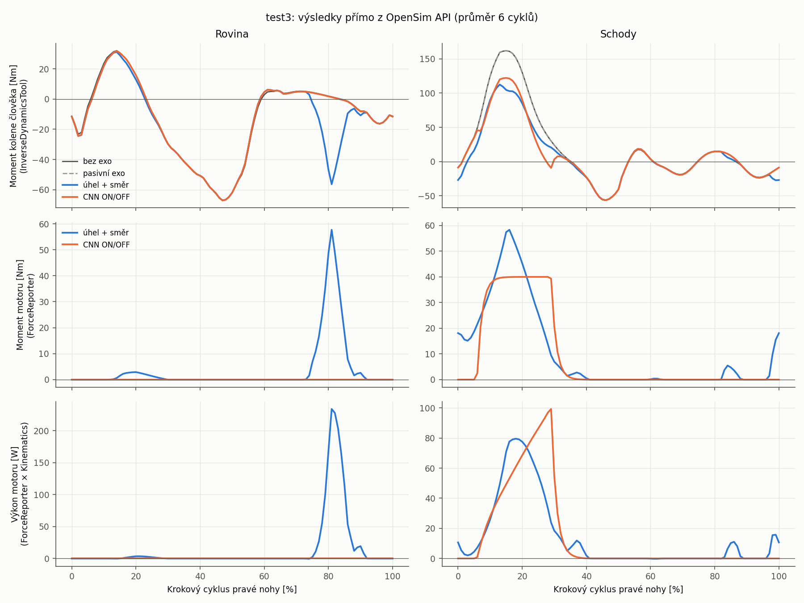
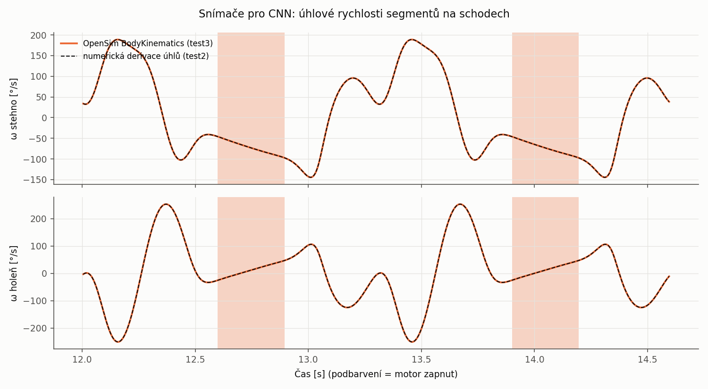

# test3 – exoskelet kolene přes OpenSim API (Python)

Stejná úloha jako v `../test2`: 15 m chůze (rovina + 17 schodů), exoskelet pravého kolene
a dvě řízení motoru (podle úhlu + směru a CNN ON/OFF). Rozdíl je v provedení. **Každý krok
simulace teď počítají nástroje a komponenty OpenSim API** a moment, který musí dodat člověk,
vrací přímo `InverseDynamicsTool`. Motor exoskeletu je v modelu jako aktuátor s řídicí jednotkou.
Nic se tedy neodečítá v Pythonu.

Výsledky se s test2 shodují (max. rozdíl momentu kolene člověka ≤ 0,0001 N m),
viz `results/souhrn_test3.md`.

## Co dělá OpenSim API v jednotlivých krocích

| Krok | Skript | OpenSim API | Dříve v test2 |
|---|---|---|---|
| Model s exo | `s1_model.py` | `Model`, `Body`, `WeldJoint`, `Mesh`; osa kloubu z `Frame.findTransformBetween`; motor = **`CoordinateActuator` `exo_motor`** + **`PrescribedController`**; řízení podle úhlu = `ExpressionBasedCoordinateForce` | stejné tělesa, ale motor jen jako síla/odečet |
| GRF pro hmotu exo | `s2_grf.py` | `InverseDynamicsTool` (bez vnějších sil), `TimeSeriesTable`, `STOFileAdapter`, **`ExternalLoads`/`ExternalForce` sestavené v kódu** | ručně psané XML a vlastní čtení/zápis .mot |
| Snímače pro CNN | `s3_cnn.py` | **`AnalyzeTool` + `BodyKinematics`**: úhlová rychlost stehna a holeně vůči zemi; úhel kolene ze souřadnice modelu | numerická derivace úhlů v numpy |
| Řízení CNN | `s3_cnn.py` | výstup sítě (20 Hz, ON/OFF, náběh 20 ms) → **`PiecewiseLinearFunction` v `PrescribedController`** motoru | moment se odečítal od výsledku ID |
| Dynamika | `s4_dynamika.py` | **`InverseDynamicsTool` s aktivním motorem v modelu** → přímo moment člověka; **`AnalyzeTool` + `ForceReporter` + `Kinematics`** → moment a výkon motoru | `M_člověk = M_pasivní − τ` v Pythonu |
| Vizualizace | `s6_vizualizace.py` | **Simbody visualizer** (`ModelVisualizer`): přehrání modelu, kamera v každém snímku přesunutá k pánvi (`setCameraTransform`, `pointCameraAt`) | vlastní vykreslování v matplotlib |
| Vyhodnocení | `s5_report.py` | čtení výsledků přes `TimeSeriesTable` | – |

Neuronová síť se počítá v numpy s váhami natrénovanými v test2 (`test2/results/cnn/cnn_vahy.npz`).
OpenSim v Pythonu neumožňuje napsat vlastní komponentu `Controller`, proto řídicí smyčka běží
mimo model a do modelu se vkládá její výstup jako předepsaný průběh řízení motoru.
Snímače pro síť ale počítá OpenSim (`BodyKinematics`) a rozhodnutí sítě se shodují s test2
ve 100 % vzorků. Rychlosti segmentů se liší nejvýše o 0,6 °/s, protože OpenSim derivuje splajn
a test2 derivoval numericky.

## Kontroly

* Inverzní dynamika bez exo = výsledek test1 (rozdíl 0).
* Zbytkové síly na pánvi s exo = bez exo (síly země jsou správně dopočtené pro hmotu exo).
* Moment motoru z `ForceReporter` = rozdíl ID pasivní − aktivní (rozdíl 0,000 N m).
* Moment člověka proti test2: max. rozdíl 0,0000 N m (bez exo, pasivní, úhel + směr), 0,0001 N m (CNN).

## Výsledky (pravé koleno, průměr 6 kroků)

| | bez exo | úhel + směr | CNN ON/OFF |
|---|---|---|---|
| Schody: špička extenzního momentu | 161,8 N m | 112,5 N m | 122,1 N m |
| Schody: kladná práce svalů kolene | 71,6 J | 54,9 J | 53,1 J |
| Rovina: RMS momentu kolene | 28,9 N m | 30,7 N m | 28,8 N m (motor se nezapne) |




## Spuštění (Python 3.8 s OpenSim 4.5)

```bash
cd scripts
PY=/c/Users/bubli/.pyenv/pyenv-win/versions/3.8.10/python.exe
$PY run_all.py                      # kroky 1-5, asi 20 s
$PY s6_vizualizace.py --rychlost 0.5 # přehrání v Simbody visualizeru (otevře okno)
```

`s6_vizualizace.py` má volby `--od`, `--do` (čas v s), `--rychlost` (násobek reálného času) a
`--fps`. Stav motoru se vypisuje do konzole. Video lze uložit přímo ve visualizeru
(menu *File → Save Movie*). Polohu kamery vůči pánvi určuje `CAM_OFFSET` ve skriptu.
Skript si sám přidá `C:\OpenSim 4.5\bin` do PATH a přepne pracovní adresář na disk C:,
protože Simbody jinak `simbody-visualizer.exe` nenajde: rozdělí PATH i podle dvojtečky
a ztratí písmeno disku.

## Vstupy

Model, kinematika a reakční síly jsou z `../test1`. Geometrie (STL) a hmotnosti exoskeletu,
křivka řízení podle úhlu a váhy CNN jsou z `../test2`. test3 je proto potřeba spouštět až po
výpočtu test1 a test2.

## Výstupy

| Soubor | Obsah |
|---|---|
| `model/subject01_stairs_exo.osim` | model s exo a motorem řízeným CNN (pro GUI) |
| `model/subject01_stairs_exo_{pasivni,uhel_smer,cnn}.osim` | varianty pro analýzu |
| `data/walk_stairs_grf_exo.mot`, `*.xml` | reakční síly země pro model s exo, ExternalLoads |
| `results/ID_*.sto` | inverzní dynamika (moment člověka) |
| `results/exo_*_ForceReporter_forces.sto`, `*_Kinematics_u.sto` | moment motoru a rychlosti |
| `results/cnn_rizeni.sto` | snímače, P(ON), stav a moment motoru |
| `results/souhrn_test3.md`, `graf_t3_*.png` | souhrn a grafy |
