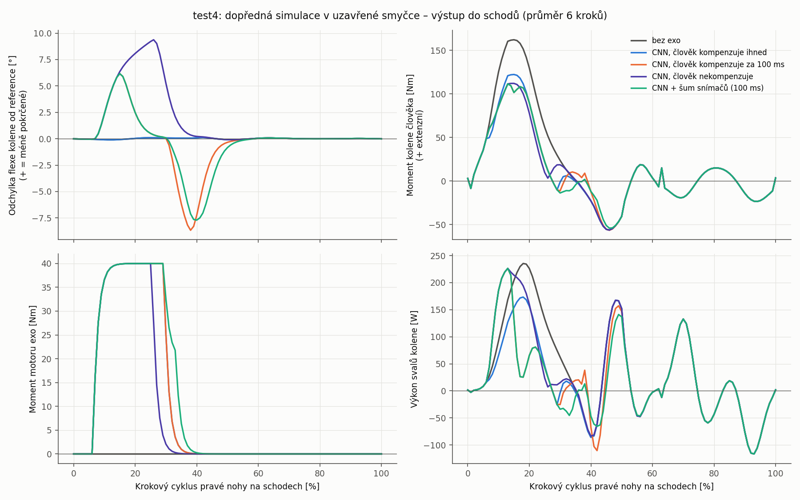
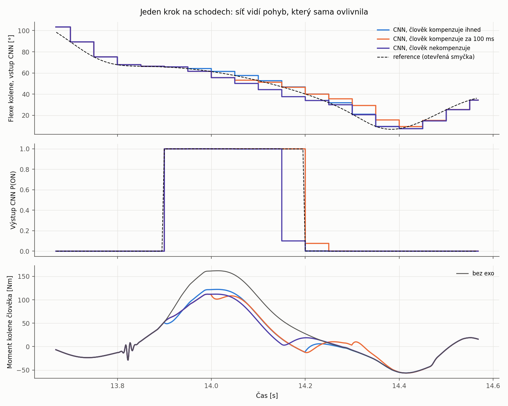

# test4 – dopředná simulace v uzavřené smyčce s řízením CNN (OpenSim API)

V test2 a test3 byl pohyb předepsaný (inverzní dynamika), takže síť rozhodovala podle naměřeného
pohybu a moment exoskeletu neměl na pohyb vliv. **V test4 se pohyb počítá dopřednou simulací**
(`osim.Manager`). Síť dostává snímače ze *simulovaného* stavu, ten její rozhodnutí mění, a smyčka
se tak uzavírá: síť vidí účinek vlastního motoru.



## Jak simulace funguje

```
každou 1 ms (1 kHz):
  stav modelu (q, u) ──► člověk: regulátor s vypočteným momentem (jako CMC)
                          udot* = udot_ref + Kp·(q_ref − q) + Kd·(u_ref − u)      (ωn = 40 rad/s)
                          τ_člověk = InverseDynamicsSolver(stav, udot*, odhad momentu exo)
  každých 50 ms (20 Hz):
  stav modelu ──► snímače (úhel kolene, ω stehna a holeně z Body.getAngularVelocityInGround)
             ──► CNN (okno 1 s) ──► ON/OFF ──► motor 40 Nm s náběhem 20 ms
  momenty ──► ScalarActuator.setOverrideActuation ──► osim.Manager.integrate(t + 1 ms)
```

* **Model:** model z test3 s exoskeletem. Svaly jsou odebrané a člověk je reprezentovaný aktuátorem
  `CoordinateActuator` v každé souřadnici. U pánve jde o reziduální aktuátory jako v CMC/RRA.
* **Reakční síly země** jsou předepsané z dat (`ExternalForce` ze souboru, pro hmotu exo dopočtené
  v test3). Kontakt chodidla se zemí se nemodeluje.
* **Reference** (q, u, udot) pochází z GCV splajnů OpenSim (`GCVSplineSet`), stejně jako
  v `InverseDynamicsTool`.
* **CNN** jsou váhy natrénované v test2 a inference v numpy (`test3/scripts/s3_cnn.py`).

### Scénáře: jak člověk počítá s pomocí exoskeletu

| Scénář | Co člověk ví o momentu motoru |
|---|---|
| `bez_exo` | motor vypnutý, ověření simulace |
| `cnn_clovek_idealni` | zná ho okamžitě (ideální adaptace) |
| `cnn_clovek_100ms` | zná ho se zpožděním 100 ms (reakční doba / adaptace) |
| `cnn_clovek_nekompenzuje` | vůbec, motor je pro něj porucha, kterou koriguje jen zpětná vazba |
| `cnn_sum_snimacu` | jako 100 ms a navíc šum snímačů 1° a 12 °/s |

## Výsledky (pravé koleno, výstup do schodů, průměr 6 kroků)

| Scénář | Špička momentu kolene | Kladná práce svalů kolene | Odchylka kolene RMS / max | Motor ON | Shoda rozhodnutí s otevřenou smyčkou |
|---|---|---|---|---|---|
| bez exo | 162,1 N m | 72,2 J | 0,06° / 0,12° | 0 % | – |
| člověk kompenzuje ihned | 122,3 N m | 53,1 J | 0,06° / 0,12° | 23,1 % | 99,7 % |
| člověk kompenzuje za 100 ms | 112,0 N m | 51,3 J | 2,7° / 8,7° | 23,1 % | 99,7 % |
| člověk nekompenzuje | 112,1 N m | 64,5 J | 3,4° / 9,4° | 19,2 % | 96,2 % |
| šum snímačů + 100 ms | 112,0 N m | 48,6 J | 2,8° / 9,5° | 25,0 % | 97,8 % |

Na rovině se motor v žádném scénáři nezapnul.

**Co ukazuje uzavřená smyčka**

* Při **ideální kompenzaci** se pohyb nezmění a výsledek odpovídá inverzní dynamice z test3
  (RMS rozdílu 1,8 N m). Rozhodnutí sítě se shodují s otevřenou smyčkou v 99,8 % času.
  Dopředná simulace tak potvrzuje dřívější výsledky.
* Když člověk motor **nekompenzuje**, koleno se po zapnutí motoru natahuje rychleji
  (až o 9,4° méně pokrčené). Síť to „vidí“ a **vypne motor o ~50 ms dřív** (motor ON 19 % místo 23 %).
  Práce svalů kolene klesne jen na 64,5 J, protože část energie motoru jde do změny pohybu.
* Při **zpoždění 100 ms** vzniká odchylka po zapnutí motoru (koleno se natáhne asi o 6° víc, člověk
  ještě nepočítá s pomocí) i po jeho vypnutí (koleno se pokrčí až o 8,7° víc, člověk ještě počítá
  s pomocí, která už nepůsobí). Rozhodování sítě to téměř neovlivní (shoda 99,7 %).
* **Šum snímačů** změní rozhodnutí sítě jen v okrajích kroku (shoda 97,8 %). Žádné falešné
  zapnutí na rovině nevzniklo.



## Kontroly

* Simulace bez exo proti inverzní dynamice (test3): RMS rozdílu momentu kolene 1,6 N m, odchylka
  kolene od reference max 0,12°. Ojedinělé špičky rozdílu (až ~30 N m na 1–3 ms) vznikají při odrazu
  chodidla, kdy reakční síla skokem klesne. Simulace běží po 1 ms, výsledek ID je po 5 ms.
* Podrobná tabulka je v `results/souhrn_test4.md`.

## Technické poznámky k OpenSim API

* `Manager` nejde inicializovat opakovaně. Protože se přepsané momenty aktuátorů (diskrétní
  proměnné stavu) mění v každém kroku, vytváří se pro každý krok 1 ms nový `Manager`.
  Celá simulace 20 s trvá asi 45 s.
* Analýza `Kinematics` v `AnalyzeTool` vrací zrychlení z dynamiky modelu bez pohonu, ne derivaci
  pohybu. Referenční zrychlení proto pochází z `GCVSplineSet`.
* `Frame.getAngularVelocityInGround` vrací u stavu zkopírovaného z `Manageru` zastaralou hodnotu
  z mezipaměti. Snímače se proto počítají na samostatném stavu, do kterého se zkopírují q a u.
* `ExternalForce` si drží jen odkaz na `Storage` s daty, takže `Storage` musí žít stejně dlouho jako model.

## Omezení

* **Reakční síly země jsou předepsané**, chodidlo není ke schodu připoutané kontaktem. Moment
  motoru ve stoji proto částečně „roztáčí“ bérec a chodidlo, místo aby zvedal tělo, a odchylky
  pohybu ve scénářích bez plné kompenzace jsou spíš horním odhadem. Realističtější by byl model
  kontaktu (např. `SmoothSphereHalfSpaceForce`) nebo vazby chodidla ve stoji.
* Člověk je regulátor s vypočteným momentem (ideální znalost dynamiky vlastního těla), ne svaly.
  Pánev drží reziduální aktuátory: na schodech do 5 N RMS, na rovině 26 N RMS jako v naměřených datech.

## Spuštění (Python 3.8 s OpenSim 4.5; předpokládá spočítaný test3)

```bash
cd scripts
PY=/c/Users/bubli/.pyenv/pyenv-win/versions/3.8.10/python.exe
$PY run_all.py                                   # 5 scénářů (~4 min) + vyhodnocení
$PY s1_simulace.py cnn_clovek_nekompenzuje       # jen vybraný scénář
$PY s3_vizualizace.py --scenar cnn_clovek_nekompenzuje --rychlost 0.5   # Simbody visualizer
```

Výstupy v `results/`:
* `sim_<scénář>.sto`: stavy, momenty člověka, snímače, P(ON), moment motoru (1 kHz; ~17 MB, není v gitu, vytvoří ho `s1_simulace.py`),
* `sim_<scénář>_pohyb.mot`: simulovaný pohyb pro OpenSim GUI (File → Load Motion na
  `test3/model/subject01_stairs_exo_pasivni.osim`),
* `souhrn_test4.md` a grafy.
