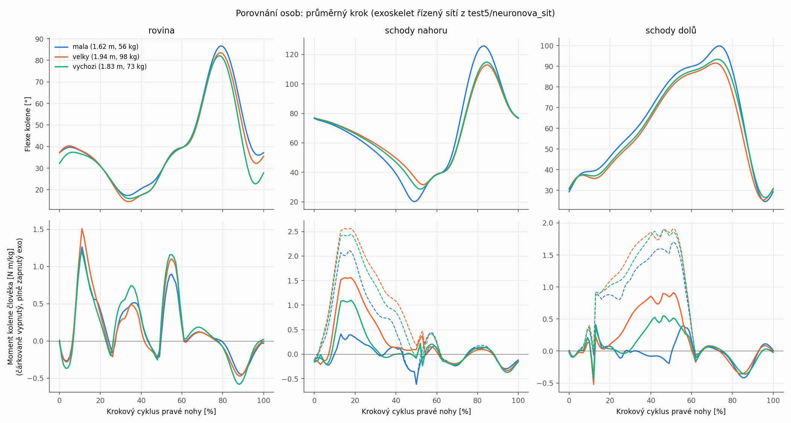
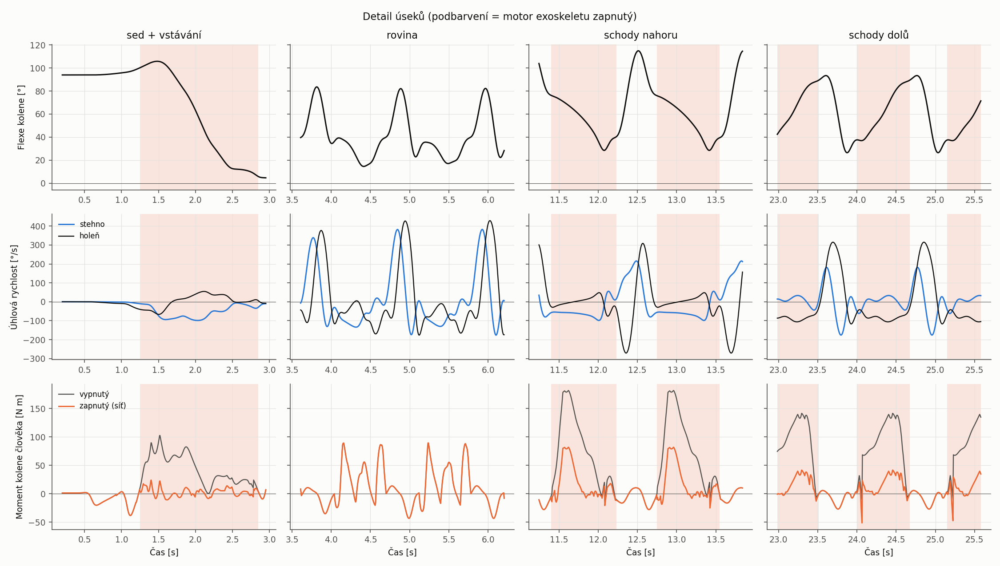
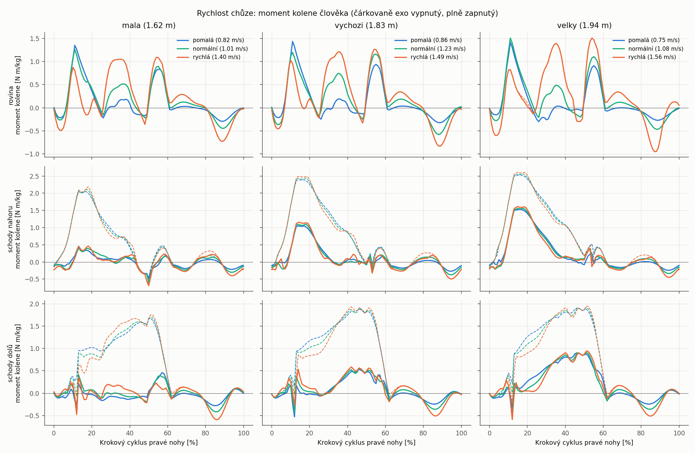

# test5 – vstávání ze židle, 5 m po rovině, 5 m do schodů a 5 m ze schodů s exoskeletem

Scénář je vytvořený přes OpenSim API v Pythonu. Model *Gait10dof18musc* se **škáluje na zadanou osobu
(`osoba.json`)**. Na pravém koleni je exoskelet z test2. Jeho motor řídí konvoluční neuronová síť,
která **kompenzuje moment kolene** při vstávání ze židle, chůzi do schodů a chůzi ze schodů (brzdění).
Na rovině nepomáhá. Síť se **učí z hodnot chůze exportovaných ze simulace** ve složce
[`neuronova_sit/`](neuronova_sit).



## 1. Osoba: `osoba.json`

```json
{
  "jmeno": "vychozi",
  "vyska_m": 1.834,
  "hmotnost_kg": 72.6,
  "segmenty_m": {"stehno": null, "berec": null, "chodidlo": null},
  "skupina": "vychozi",
  "styl_chuze": {"skalovat_s_delkou_nohy": true, "tempo": 1.0, "delka_kroku": 1.0},
  "prostredi": {"vyska_sedaku_m": 0.46, "delka_roviny_m": 5.0, "vyska_stupne_m": 0.17,
                "hloubka_stupne_m": 0.29, "pocet_stupnu": 17, "podesta_m": 0.9},
  "exoskelet": {"vahy_site": "neuronova_sit/vahy/cnn_regrese.npz", "max_moment_Nm": 100.0,
                "podil_kompenzace": 1.0, "mrtve_pasmo_Nm_kg": 0.1, "moment_zapnuto_Nm": 40.0}
}
```

| Položka | Význam |
|---|---|
| `jmeno` | název osoby. Výstupy jdou do `data/<jmeno>`, `model/<jmeno>`, `results/<jmeno>`, `setup/<jmeno>` |
| `vyska_m`, `hmotnost_kg` | výška a hmotnost bez exoskeletu |
| `segmenty_m` | délka stehna (kyčel–koleno), bérce (koleno–hlezno) a chodidla (pata–špička). `null` = odvodí se z výšky v poměrech výchozího modelu (1,834 m: 0,454 / 0,425 / 0,245 m) |
| `styl_chuze.skalovat_s_delkou_nohy` | `true`: délka kroku ~ délka nohy, doba kroku ~ √(délka nohy) (dynamická podobnost). `false`: kroky jako u výchozího modelu |
| `skupina` | osoba, ke které záznam patří (varianty rychlosti mají stejnou skupinu). Učení sítě testuje vždy celou neviděnou skupinu |
| `styl_chuze.tempo` | násobek všech dob (vstávání, švih, dvojí opora). 1,2 = o 20 % pomalejší |
| `styl_chuze.delka_kroku` | násobek délky kroku na rovině. Rychlost chůze ≈ délka_kroku / tempo |
| `prostredi` | židle a schodiště (stejné pro všechny osoby, pokud je nezměníš) |
| `exoskelet.vahy_site` | váhy sítě. Typ (regrese / ON-OFF) je uložený v souboru. Když soubor chybí, použije se síť z test2 |
| `exoskelet.max_moment_Nm` | omezení momentu motoru (výchozí 100 N m) |
| `exoskelet.podil_kompenzace` | jakou část odhadnutého momentu převezme motor (1,0 = celý) |
| `exoskelet.mrtve_pasmo_Nm_kg` | výstupy sítě pod touto hodnotou = 0 (aby motor nepomáhal na rovině) |
| `exoskelet.moment_zapnuto_Nm` | moment motoru ve stavu ON (jen pro síť typu ON/OFF) |

Ukázkové osoby jsou ve složce [`osoby/`](osoby). Každá má tři rychlosti chůze, celkem 9 záznamů:

| Skupina | Výška, hmotnost | pomalá | normální | rychlá |
|---|---|---|---|---|
| `mala` | 1,62 m, 56 kg | 0,82 m/s | 1,01 m/s | 1,40 m/s |
| `vychozi` | 1,83 m, 72,6 kg | 0,86 m/s | 1,23 m/s | 1,49 m/s |
| `velky` | 1,94 m, 98 kg | 0,75 m/s | 1,08 m/s | 1,56 m/s |

* Pomalá varianta (`*_pomala.json`) má tempo ×1,25 a délku kroku ×0,9.
* Rychlá varianta (`*_rychla.json`) má tempo ×0,82 a délku kroku ×1,1.
* Rychlosti jsou na rovině a vychází z délky a doby kroku.

**Co se s osobou změní**

* **Model:** `s0_osoba.py`, `Model.scale` v OpenSim API.
  * Měřítka stehna, bérce a chodidla odpovídají délkám segmentů, pánev a trup se škálují podle výšky.
  * Hmotnost se rozdělí mezi segmenty ve stejném poměru jako ve výchozím modelu.
  * Úměrně se posunou klouby a kosti, přepočítá se setrvačnost.
* **Exoskelet:** díly se zvětší nebo zmenší s délkou stehna a bérce, hmotnost 1,76 kg zůstane stejná.
  Osa kloubu se znovu dorovná na koleno (nesouosost 1,8–2,2 mm).
* **Styl chůze:**
  * Pohyb se pro každou osobu syntetizuje znovu, s chodidly škálovanými podle délky chodidla.
  * Délky a doby kroků se mění podle `styl_chuze`.
  * Výška pánve, póza nohy při dopadu a korekce rovnováhy se dopočítají z modelu.
  * Schody a židle zůstávají stejné, takže menší člověk na nich víc ohýbá koleno (viz tabulka níže).

## 2. Výpočet

```bash
cd scripts
PY38=/c/Users/bubli/.pyenv/pyenv-win/versions/3.8.10/python.exe
PY311=/c/Users/bubli/.pyenv/pyenv-win/versions/3.11.9/python.exe
$PY38 run_all.py                                             # osoba z osoba.json (vše)
$PY38 run_all.py --data ../osoby/mala.json ../osoby/velky.json   # jen data pro síť
$PY38 run_all.py --rizeni ../osoby/mala.json                 # jen řízení exo + grafy
OSOBA=../osoby/mala.json $PY311 s7_anim_render.py            # animace osoby
$PY38 s9_porovnani.py                                        # porovnání osob
```

| Krok | Skript | Co dělá |
|---|---|---|
| 0 | `s0_osoba.py` | škálovaný model osoby |
| 1 | `s1_pohyb.py` | syntéza pohybu: plán kroků, švihy bez kolize, inverzní kinematika |
| 2 | `s2_model.py` | model s tratí, židlí a exoskeletem (OpenSim API) |
| 3 | `s3b_rovnovaha.py` (+ `s3_grf.py`) | reakční síly chodidel a sedáku z dynamiky těla; iterační korekce rovnováhy |
| 8 | `s8_export_nn.py` | **export hodnot chůze pro síť** → `neuronova_sit/data/<jmeno>.csv` |
| 4 | `s4_exo.py` | řízení CNN (snímače z `BodyKinematics`), moment kolene s vypnutým a zapnutým exo (`InverseDynamicsTool`) |
| 5 | `s5_grafy.py` | grafy a souhrn osoby |
| 6, 7 | `s6_anim_export.py`, `s7_anim_render.py` | animace s kamerou sledující model |
| 9 | `s9_porovnani.py` | porovnání osob |

## 3. Řízení: kompenzace momentu kolene neuronovou sítí

Postup: **data všech osob (`run_all.py --data`) → učení (`neuronova_sit/trenink.py`) → řízení
(`run_all.py --rizeni`)**. Podrobnosti jsou v [`neuronova_sit/README.md`](neuronova_sit/README.md).

* **Vstupy:** úhel kolene a úhlová rychlost stehna a holeně (snímače exoskeletu), 20 Hz, okno 1 s.
* **Výstup:** odhad momentu kolene, který má převzít motor [N m/kg] (regrese).
  * Řízení výstup vynásobí hmotností uživatele s exo a podílem kompenzace a omezí ho na
    `max_moment_Nm`.
  * Motor má náběh 20 ms.
* **Cíl učení:** extenzní moment kolene člověka (bez exo) v úsecích
  * **schody nahoru** (hlavní úsek, při učení dvojnásobná váha),
  * **sed + vstávání**,
  * **schody dolů** (motor dodává extenzní moment, zatímco se koleno ohýbá, tedy brzdí).

  Na rovině, podestě a při stání je cíl 0.
* **Bezpečnost proti překompenzaci:**
  * Síť odhaduje moment o 50 ms dopředu, což vyrovná zpoždění řízení a motoru.
  * Přebytek (motor dává víc, než je potřeba) se při učení trestá 3× víc než nedostatek.
  * Výstupy pod 0,1 N m/kg se nulují.
* **Test na osobě, kterou síť při učení neviděla** (učí se na zbylých dvou osobách ve všech
  rychlostech): R² 0,76–0,96, chyba 0,15–0,35 N m/kg. Na rovině je výstup 0,004–0,015 N m/kg.

Předchozí řízení ON/OFF (40 N m jen do schodů) zůstává k dispozici: `"typ": "onoff"` v `nastaveni.json`.

## 4. Výsledky

Výchozí osoba (1,83 m, 72,6 kg; [`results/vychozi/souhrn_test5.md`](results/vychozi/souhrn_test5.md)),
motor max 100 N m:

| Úsek | Max. moment kolene vyp. → zap. | Extenzní impuls vyp. → zap. | Přebytek motoru (překompenzace) | Práce motoru |
|---|---|---|---|---|
| sed + vstávání | 103 → 24 N m | 70 → 8 N m s (−89 %) | 8 % času, max 11 N m | +65 J |
| rovina | 89 → 89 N m | 86 → 85 N m s | 0 % | 0 J |
| schody nahoru | 182 → 127 N m | 520 → 142 N m s (−73 %) | 8 % času, max 27 N m | +384 J |
| schody dolů | 183 → 120 N m | 530 → 109 N m s (−79 %) | 5 % času, max 41 N m | −683 J (brzdí) |



Průměrný krok, všechny osoby a rychlosti ([`results/porovnani_rychlosti.md`](results/porovnani_rychlosti.md)).
Max. moment kolene vyp. → zap. [N m/kg]:

| Osoba | schody nahoru | schody dolů |
|---|---|---|
| malá (56 kg) | 2,05–2,19 → 0,41–0,46 | 1,67–1,75 → 0,34–0,46 |
| výchozí (72,6 kg) | 2,39–2,49 → 1,05–1,15 | 1,88–1,93 → 0,54–0,59 |
| vysoká (98 kg) | 2,53–2,61 → 1,53–1,61 | 1,90–1,94 → 0,90–0,94 |



* **Vstávání** téměř eliminováno (zbytek 0,2–0,5 N m/kg).
* **Do schodů a ze schodů:** zbytek je hlavně omezení motoru na 100 N m. Malé osobě stačí
  (zbytek 0,4 N m/kg), vysoké chybí až 155 N m. Při neomezeném motoru by zbyla jen nepřesnost
  sítě (sloupec „neomezený motor“ v `souhrn_test5.md`). Silnější motor nastavíš
  v `max_moment_Nm`.
* **Rovina:** moment člověka beze změny, motor je v klidu.
* **Překompenzace:** zbývá krátce při rychlých změnách. Při došlapu na nižší schod a na konci
  sestupu je to až 40–60 N m po desítky ms. Pro skutečný exoskelet je vhodné doplnit omezení
  rychlosti náběhu a bezpečnostní logiku (například vypnutí při natažené noze).
* **Styl chůze se mění** s osobou i rychlostí. Menší osoba dělá kratší kroky a víc ohýbá koleno.
  Rychlejší chůze zvyšuje momenty hlavně na rovině, na schodech jen málo.
* Výstupy každého záznamu jsou v `results/<jmeno>/`:
  * `graf_t5_celek.png`, `graf_t5_useky.png`, `souhrn_test5.md`,
  * `animace/vstavani_schody_exo.mp4`.

## Omezení

* **Pohyb je syntetický** a korigovaný na rovnováhu. Momenty kolene jsou vyšší než typické hodnoty
  v literatuře:
  * rovina 1,2–1,5 N m/kg (literatura 0,5–0,9),
  * schody 1,7–2,6 N m/kg (literatura 1,0–1,6).

  Ber je jako konzervativní odhad.
* U vysoké osoby je při vstávání ze sedáku 46 cm větší zbytkový moment na pánvi (54 N m RMS):
  syntetické vstávání tam méně odpovídá dynamice.
* Rychlé varianty mají na rovině větší zbytkový moment na pánvi (24–26 N m RMS proti 5–13 N m
  u pomalých a normálních). U rychlé vysoké osoby (krok 0,75 m) noha těsně před dopadem
  na čtyřech místech nedosáhne na plánovanou polohu. Těchto 70–100 ms je nahrazeno interpolací.
* Reakční síly a síla sedáku jsou dopočtené. Výpočet je inverzní dynamika (otevřená smyčka).
  Uzavřenou smyčku umí test4. Model je rovinný.
* Síť se učí ze simulovaných dat. Před použitím na skutečném exoskeletu je nutné ji doučit
  na naměřených datech z IMU.
* Motor 100 N m je víc, než unese pohon z CAD v test2 (vlnový převod, vrchol 60 N m). Hmotnost
  exoskeletu se se silnějším motorem nemění, ve skutečnosti by rostla.
* Kompenzace je spočtená inverzní dynamikou: pohyb se s pomocí nemění. Jak by se chůze
  přizpůsobila, by ukázala dopředná simulace (test4).
